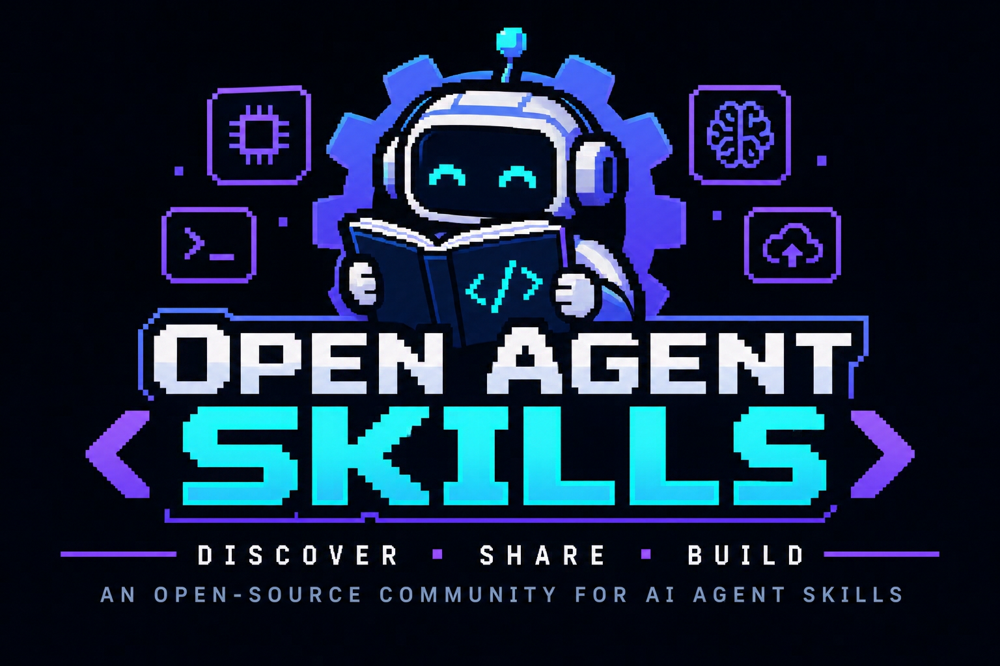

<div align="center">



<br />
<br />

[](https://claude.ai)
[](https://claude.com/claude-code)
[![ChatGPT](https://img.shields.io/badge/ChatGPT-10A37F?style=flat-square&logo=data:image/svg%2bxml;base64,PHN2ZyBmaWxsPSJ3aGl0ZSIgcm9sZT0iaW1nIiB2aWV3Qm94PSIwIDAgMjQgMjQiIHhtbG5zPSJodHRwOi8vd3d3LnczLm9yZy8yMDAwL3N2ZyI+PHRpdGxlPk9wZW5BSTwvdGl0bGU+PHBhdGggZD0iTTIyLjI4MTkgOS44MjExYTUuOTg0NyA1Ljk4NDcgMCAwIDAtLjUxNTctNC45MTA4IDYuMDQ2MiA2LjA0NjIgMCAwIDAtNi41MDk4LTIuOUE2LjA2NTEgNi4wNjUxIDAgMCAwIDQuOTgwNyA0LjE4MThhNS45ODQ3IDUuOTg0NyAwIDAgMC0zLjk5NzcgMi45IDYuMDQ2MiA2LjA0NjIgMCAwIDAgLjc0MjcgNy4wOTY2IDUuOTggNS45OCAwIDAgMCAuNTExIDQuOTEwNyA2LjA1MSA2LjA1MSAwIDAgMCA2LjUxNDYgMi45MDAxQTUuOTg0NyA1Ljk4NDcgMCAwIDAgMTMuMjU5OSAyNGE2LjA1NTcgNi4wNTU3IDAgMCAwIDUuNzcxOC00LjIwNTggNS45ODk0IDUuOTg5NCAwIDAgMCAzLjk5NzctMi45MDAxIDYuMDU1NyA2LjA1NTcgMCAwIDAtLjc0NzUtNy4wNzI5em0tOS4wMjIgMTIuNjA4MWE0LjQ3NTUgNC40NzU1IDAgMCAxLTIuODc2NC0xLjA0MDhsLjE0MTktLjA4MDQgNC43NzgzLTIuNzU4MmEuNzk0OC43OTQ4IDAgMCAwIC4zOTI3LS42ODEzdi02LjczNjlsMi4wMiAxLjE2ODZhLjA3MS4wNzEgMCAwIDEgLjAzOC4wNTJ2NS41ODI2YTQuNTA0IDQuNTA0IDAgMCAxLTQuNDk0NSA0LjQ5NDR6bS05LjY2MDctNC4xMjU0YTQuNDcwOCA0LjQ3MDggMCAwIDEtLjUzNDYtMy4wMTM3bC4xNDIuMDg1MiA0Ljc4MyAyLjc1ODJhLjc3MTIuNzcxMiAwIDAgMCAuNzgwNiAwbDUuODQyOC0zLjM2ODV2Mi4zMzI0YS4wODA0LjA4MDQgMCAwIDEtLjAzMzIuMDYxNUw5Ljc0IDE5Ljk1MDJhNC40OTkyIDQuNDk5MiAwIDAgMS02LjE0MDgtMS42NDY0ek0yLjM0MDggNy44OTU2YTQuNDg1IDQuNDg1IDAgMCAxIDIuMzY1NS0xLjk3MjhWMTEuNmEuNzY2NC43NjY0IDAgMCAwIC4zODc5LjY3NjVsNS44MTQ0IDMuMzU0My0yLjAyMDEgMS4xNjg1YS4wNzU3LjA3NTcgMCAwIDEtLjA3MSAwbC00LjgzMDMtMi43ODY1QTQuNTA0IDQuNTA0IDAgMCAxIDIuMzQwOCA3Ljg3MnptMTYuNTk2MyAzLjg1NThMMTMuMTAzOCA4LjM2NCAxNS4xMTkyIDcuMmEuMDc1Ny4wNzU3IDAgMCAxIC4wNzEgMGw0LjgzMDMgMi43OTEzYTQuNDk0NCA0LjQ5NDQgMCAwIDEtLjY3NjUgOC4xMDQydi01LjY3NzJhLjc5Ljc5IDAgMCAwLS40MDctLjY2N3ptMi4wMTA3LTMuMDIzMWwtLjE0Mi0uMDg1Mi00Ljc3MzUtMi43ODE4YS43NzU5Ljc3NTkgMCAwIDAtLjc4NTQgMEw5LjQwOSA5LjIyOTdWNi44OTc0YS4wNjYyLjA2NjIgMCAwIDEgLjAyODQtLjA2MTVsNC44MzAzLTIuNzg2NmE0LjQ5OTIgNC40OTkyIDAgMCAxIDYuNjgwMiA0LjY2ek04LjMwNjUgMTIuODYzbC0yLjAyLTEuMTYzOGEuMDgwNC4wODA0IDAgMCAxLS4wMzgtLjA1NjdWNi4wNzQyYTQuNDk5MiA0LjQ5OTIgMCAwIDEgNy4zNzU3LTMuNDUzN2wtLjE0Mi4wODA1TDguNzA0IDUuNDU5YS43OTQ4Ljc5NDggMCAwIDAtLjM5MjcuNjgxM3ptMS4wOTc2LTIuMzY1NGwyLjYwMi0xLjQ5OTggMi42MDY5IDEuNDk5OHYyLjk5OTRsLTIuNTk3NCAxLjQ5OTctMi42MDY3LTEuNDk5N1oiLz48L3N2Zz4=)](https://chatgpt.com)
[](https://antigravity.google)
[](#-what-is-a-skill)
[](#-how-to-contribute)

[](https://github.com/hanspeterdietiker/Open-Agents-Skills/pulls)
[](https://github.com/hanspeterdietiker/Open-Agents-Skills/issues)
[](https://github.com/hanspeterdietiker/Open-Agents-Skills/fork)
[](https://github.com/hanspeterdietiker/Open-Agents-Skills/stargazers)
[](https://github.com/hanspeterdietiker/Open-Agents-Skills/graphs/contributors)
[](LICENSE)
[](#)

🌐 **English** | [Português](README.md)

**An open-source, academic and collaborative community to discover, share and build _Skills_ for AI Agents — from Brazil to the world.** 🇧🇷 🌎

[About](#-about-the-project) •
[What is a Skill](#-what-is-a-skill) •
[Available skills](#-available-skills) •
[Structure](#-repository-structure) •
[Usage](#-usage) •
[How to contribute](#-how-to-contribute) •
[Community](#-community)

</div>

---

## 📖 About the project

**Open Agent Skills** was born with a simple purpose: **to democratize knowledge about how to teach AI Agents to perform specialized tasks.**

Language models like **Claude** are extremely capable, but they become even more useful when given *packaged, reusable and versioned instructions* on **how** to carry out a specific kind of work — whether that's writing commit messages following Conventional Commits, reviewing software architecture, generating reports, running a debugging process or automating an everyday workflow. These instructions are called **Skills**.

This repository is an **open collection of Skills**, built by and for the AI community, around four pillars:

| Pillar | Description |
| --- | --- |
| 🔓 **Open-source** | All content is open, auditable and free to use, adapt and redistribute. |
| 🎓 **Academic** | We encourage well-documented Skills grounded in best practices and references, also serving as study material for students, researchers and teachers. |
| 🤝 **Interactive** | Skills evolve through issues, discussions, reviews and pull requests — every contribution is reviewed by the community. |
| 🌎 **Brazil and abroad** | A meeting point for the Brazilian AI community, open to contributions from all over the world, in **Portuguese** and **English**. |

### 🎯 Goals

- **Discover** — gather useful, tested and well-explained Skills in one place.
- **Share** — make it easy for anyone to publish and reuse Skills in their own agents.
- **Build** — serve as a lab to experiment with, compare and improve prompt engineering, *context engineering* and agent design techniques.
- **Teach** — produce high-quality learning material about AI Agents, lowering the barrier to entry for the Brazilian community and beyond.

---

## 🧠 What is a Skill?

A **Skill** is a package of instructions (and, optionally, scripts, templates and reference files) that an AI agent loads **on demand** when the task at hand matches the Skill's description.

Each Skill lives in its own folder and has a `SKILL.md` file as its entry point, made of:

1. **YAML frontmatter** — metadata with `name` and `description`. The `description` is what the agent reads to decide *when* to trigger the Skill.
2. **Markdown body** — the instructions themselves: step-by-step guidance, rules, examples and common pitfalls.

```markdown
---
name: conventional-commits
description: Use when the user asks to create a commit or write a commit message following the Conventional Commits standard.
---

# Conventional Commits

## When to use
...

## Step by step
1. Inspect the staged diff with `git diff --staged`.
2. Identify the type of change (feat, fix, docs, refactor, ...).
3. ...

## Examples
...
```

> 💡 **Tip:** a good Skill is **focused** (solves one kind of problem), **actionable** (says exactly what to do) and **verifiable** (includes criteria to tell whether the task was done well).

---

## 📦 Available skills

Alphabetical glossary — each entry links to its `SKILL.md`.

- **[`clean-code`](skills/clean-code/SKILL.md)** — writing, reviewing or refactoring code following *Clean Code* principles.
  <br><sub>Author: [sickn33/agentic-awesome-skills](https://github.com/sickn33/agentic-awesome-skills) (MIT) · Basis: originally from [jackjin1997/ClawForge](https://github.com/jackjin1997/ClawForge); *Clean Code* book by Robert C. Martin</sub>
- **[`conventional-commits`](skills/conventional-commits/SKILL.md)** — creating commits following Conventional Commits.
  <br><sub>Author: [hanspeterdietiker](https://github.com/hanspeterdietiker) · Basis: [Conventional Commits 1.0.0](https://www.conventionalcommits.org/en/v1.0.0/) specification</sub>
- **[`harness-loop`](skills/harness-loop/SKILL.md)** — designing, debugging or evaluating autonomous AI agents.
  <br><sub>Author: [hanspeterdietiker](https://github.com/hanspeterdietiker) · Basis: MindStudio article [*Loop Engineering vs. Harness Engineering*](https://mindstudio.ai/blog/loop-engineering-vs-harness-engineering)</sub>
- **[`loop-impl`](skills/loop-impl/SKILL.md)** — implementing a project/epic ticket by ticket in resumable cycles.
  <br><sub>Author: [hanspeterdietiker](https://github.com/hanspeterdietiker) · Sub-skills: `clean-code` (required), `harness-loop` (optional) and [`orchestration`](https://github.com/stablyai/orca/tree/main/skills/orchestration) from [stablyai/orca](https://github.com/stablyai/orca) (optional, external, MIT)</sub>
- **[`pull-request`](skills/pull-request/SKILL.md)** — opening well-documented pull requests with `gh`.
  <br><sub>Author: [hanspeterdietiker](https://github.com/hanspeterdietiker) · Basis: `conventional-commits` skill + Conventional Commits specification</sub>

> 📜 Every `SKILL.md` carries `license` and `metadata` (author and source) fields in its frontmatter and a **Créditos / Credits** section at the end. Third-party skills keep their original license in their own folder (e.g. [`skills/clean-code/LICENSE`](skills/clean-code/LICENSE)).

---

## 🗂️ Repository structure

```text
Open-Agents-Skills/
├── assets/                  # Images and visual assets for the project
├── skills/                  # All community Skills
│   └── <skill-name>/
│       ├── SKILL.md         # Entry point (required)
│       ├── references/      # Supporting documents (optional)
│       ├── scripts/         # Helper scripts (optional)
│       └── examples/        # Usage examples (optional)
├── README.md                # Portuguese version
└── README.en.md             # English version
```

**Conventions:**

- Folder names in `kebab-case` (e.g. `code-review`, `report-generator`).
- The `name` in the frontmatter must match the folder name.
- Skills may be written in Portuguese or English — when possible, include terms in both languages in the `description` to improve triggering.
- Third-party skills, or skills inspired by other work, must credit author and source (`metadata` in the frontmatter + a **Créditos / Credits** section) and, when copied, keep the original license in the Skill's folder.

---

## 🚀 Usage

### With Claude Code

1. Clone the repository:

   ```bash
   git clone https://github.com/hanspeterdietiker/Open-Agents-Skills.git
   ```

2. Copy the desired Skill folder into Claude Code's Skills directory:

   ```bash
   # Personal Skills (available in all your projects)
   cp -r Open-Agents-Skills/skills/<skill-name> ~/.claude/skills/

   # Project Skills (shared with your team via git)
   cp -r Open-Agents-Skills/skills/<skill-name> .claude/skills/
   ```

3. Done! Claude will automatically trigger the Skill whenever the task matches its description — or you can invoke it directly with `/<skill-name>`.

### With other agents

The `SKILL.md` format is simple and Markdown-based, so it can be adapted to other agents and frameworks: just include the Skill's content in the agent's context when the matching task is detected.

---

## 🤝 How to contribute

Contributions are **very welcome** — new Skills, improvements to existing ones, fixes, translations or documentation! The workflow is:

### 1. Fork the repository 🍴

Click [**Fork**](https://github.com/hanspeterdietiker/Open-Agents-Skills/fork) at the top of the page and clone your fork:

```bash
git clone https://github.com/<your-username>/Open-Agents-Skills.git
cd Open-Agents-Skills
git checkout -b feat/my-new-skill
```

### 2. Pick or open an issue 📌

- Browse the [**open issues**](https://github.com/hanspeterdietiker/Open-Agents-Skills/issues) and pick one to work on — leave a comment on the issue so others know you're on it.
- Have a new idea? [**Open an issue**](https://github.com/hanspeterdietiker/Open-Agents-Skills/issues/new) describing the proposed Skill, the problem it solves and usage examples.

### 3. Build your contribution 🛠️

- Create the `skills/<skill-name>/` folder with a `SKILL.md` file.
- Write a clear `description` stating **when** the Skill should be used.
- Test the Skill with a real agent before submitting.
- Use [Conventional Commits](https://www.conventionalcommits.org/) for commit messages (e.g. `feat(skills): add code-review skill`).

### 4. Open a Pull Request 🚀

```bash
git push origin feat/my-new-skill
```

Open a [**Pull Request**](https://github.com/hanspeterdietiker/Open-Agents-Skills/pulls) against the `main` branch and:

- ✅ Describe what the Skill does and how it was tested.
- ✅ Reference the related issue (e.g. `Closes #12`).
- ✅ **Mention a reviewer who is a project collaborator** (e.g. `@collaborator-username`) in the PR body, or request their review from the *Reviewers* panel. Check the [contributors list](https://github.com/hanspeterdietiker/Open-Agents-Skills/graphs/contributors) to find someone who can review.

> 📝 Every PR goes through community review. Be kind, constructive and open to suggestions — the goal is to learn together!

### ✔️ Good contribution checklist

- [ ] The Skill is located at `skills/<skill-name>/SKILL.md`
- [ ] The frontmatter contains `name` and `description`
- [ ] Instructions are clear, objective and include examples
- [ ] The Skill was tested with at least one agent
- [ ] The PR references an issue and mentions a reviewer

---

## 🌐 Community

This is a project **by the community, for the community**. Students, teachers, researchers, professionals and AI enthusiasts are all welcome — in Brazil and abroad.

- 💬 Questions, ideas and proposals: open an [issue](https://github.com/hanspeterdietiker/Open-Agents-Skills/issues).
- ⭐ Like the project? Leave a **star** — it helps the community grow!
- 📣 Share it with your class, your team or your study group.

### 👥 Contributors

<a href="https://github.com/hanspeterdietiker/Open-Agents-Skills/graphs/contributors">
  
</a>

---

<div align="center">

**Open Agent Skills** — *Discover • Share • Build*

Made with 💜 by the AI community 🇧🇷 🌎

</div>
