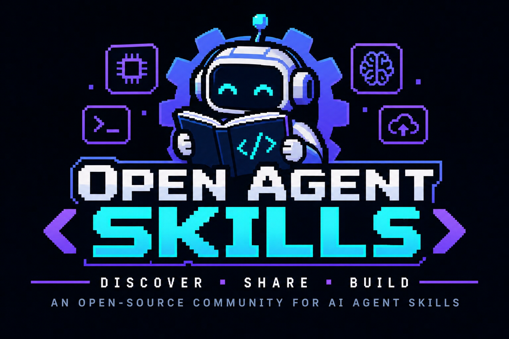

<div align="center">



<br />
<br />

[](https://claude.ai)
[](https://claude.com/claude-code)
[](#-o-que-é-uma-skill)
[](#-como-contribuir)

[](https://github.com/hanspeterdietiker/Open-Agents-Skills/pulls)
[](https://github.com/hanspeterdietiker/Open-Agents-Skills/issues)
[](https://github.com/hanspeterdietiker/Open-Agents-Skills/fork)
[](https://github.com/hanspeterdietiker/Open-Agents-Skills/stargazers)
[](https://github.com/hanspeterdietiker/Open-Agents-Skills/graphs/contributors)
[](LICENSE)
[](#)

🌐 **Português** | [English](README.en.md)

**Uma comunidade open-source, acadêmica e colaborativa para descobrir, compartilhar e construir _Skills_ para Agentes de IA — do Brasil para o mundo.** 🇧🇷 🌎

[Sobre](#-sobre-o-projeto) •
[O que é uma Skill](#-o-que-é-uma-skill) •
[Estrutura](#-estrutura-do-repositório) •
[Como usar](#-como-usar) •
[Como contribuir](#-como-contribuir) •
[Comunidade](#-comunidade)

</div>

---

## 📖 Sobre o projeto

O **Open Agent Skills** nasceu com um propósito simples: **democratizar o conhecimento sobre como ensinar Agentes de IA a executar tarefas especializadas.**

Modelos de linguagem como o **Claude** são extremamente capazes, mas tornam-se ainda mais úteis quando recebem *instruções empacotadas, reutilizáveis e versionadas* sobre **como** realizar um tipo específico de trabalho — seja escrever mensagens de commit no padrão Conventional Commits, revisar arquitetura de software, gerar relatórios, conduzir um processo de depuração ou automatizar um fluxo de trabalho do dia a dia. Essas instruções são chamadas de **Skills**.

Este repositório é um **acervo aberto de Skills**, construído pela e para a comunidade de IA, com quatro pilares:

| Pilar | Descrição |
| --- | --- |
| 🔓 **Open-source** | Todo o conteúdo é aberto, auditável e livre para ser usado, adaptado e redistribuído. |
| 🎓 **Acadêmico** | Incentivamos Skills bem documentadas, fundamentadas em boas práticas e referências, servindo também como material de estudo para estudantes, pesquisadores e professores. |
| 🤝 **Interativo** | As Skills evoluem por meio de issues, discussões, revisões e pull requests — cada contribuição é revisada pela comunidade. |
| 🌎 **Brasil e exterior** | Um ponto de encontro da comunidade brasileira de IA, aberto a contribuições do mundo todo, em **português** e **inglês**. |

### 🎯 Objetivos

- **Descobrir** — reunir em um só lugar Skills úteis, testadas e bem explicadas.
- **Compartilhar** — facilitar que qualquer pessoa publique e reutilize Skills em seus próprios agentes.
- **Construir** — servir como laboratório para experimentar, comparar e aprimorar técnicas de engenharia de prompts, *context engineering* e design de agentes.
- **Ensinar** — produzir material didático de qualidade sobre Agentes de IA em português, reduzindo a barreira de entrada para a comunidade brasileira.

---

## 🧠 O que é uma Skill?

Uma **Skill** é um pacote de instruções (e, opcionalmente, scripts, templates e arquivos de referência) que um agente de IA carrega **sob demanda** quando a tarefa em questão corresponde à descrição da Skill.

Cada Skill vive em sua própria pasta e tem como ponto de entrada um arquivo `SKILL.md`, composto por:

1. **Frontmatter YAML** — metadados com `name` e `description`. A `description` é o que o agente lê para decidir *quando* acionar a Skill.
2. **Corpo em Markdown** — as instruções propriamente ditas: o passo a passo, regras, exemplos e armadilhas comuns.

```markdown
---
name: conventional-commits
description: Use quando o usuário pedir para criar um commit ou escrever uma mensagem de commit seguindo o padrão Conventional Commits.
---

# Conventional Commits

## Quando usar
...

## Passo a passo
1. Analise o diff staged com `git diff --staged`.
2. Identifique o tipo da mudança (feat, fix, docs, refactor, ...).
3. ...

## Exemplos
...
```

> 💡 **Dica:** uma boa Skill é **focada** (resolve um tipo de problema), **acionável** (diz exatamente o que fazer) e **verificável** (inclui critérios para saber se a tarefa foi bem executada).

---

## 🗂️ Estrutura do repositório

```text
Open-Agents-Skills/
├── assets/                  # Imagens e recursos visuais do projeto
├── skills/                  # Todas as Skills da comunidade
│   └── <nome-da-skill>/
│       ├── SKILL.md         # Ponto de entrada (obrigatório)
│       ├── references/      # Documentos de apoio (opcional)
│       ├── scripts/         # Scripts auxiliares (opcional)
│       └── examples/        # Exemplos de uso (opcional)
├── README.md                # Versão em português
└── README.en.md             # Versão em inglês
```

**Convenções:**

- Nomes de pastas em `kebab-case` (ex.: `code-review`, `gerador-de-relatorios`).
- O `name` no frontmatter deve ser igual ao nome da pasta.
- Skills podem ser escritas em português ou inglês — se possível, inclua a `description` com termos nos dois idiomas para melhorar o acionamento.

---

## 🚀 Como usar

### Com o Claude Code

1. Clone o repositório:

   ```bash
   git clone https://github.com/hanspeterdietiker/Open-Agents-Skills.git
   ```

2. Copie a pasta da Skill desejada para o diretório de Skills do Claude Code:

   ```bash
   # Skills pessoais (disponíveis em todos os projetos)
   cp -r Open-Agents-Skills/skills/<nome-da-skill> ~/.claude/skills/

   # Skills do projeto (compartilhadas com o time via git)
   cp -r Open-Agents-Skills/skills/<nome-da-skill> .claude/skills/
   ```

3. Pronto! O Claude passará a acionar a Skill automaticamente quando a tarefa corresponder à sua descrição — ou você pode chamá-la diretamente com `/<nome-da-skill>`.

### Com outros agentes

O formato `SKILL.md` é simples e baseado em Markdown, portanto pode ser adaptado para outros agentes e frameworks: basta incluir o conteúdo da Skill no contexto do agente quando a tarefa correspondente for detectada.

---

## 🤝 Como contribuir

Contribuições são **muito bem-vindas** — sejam novas Skills, melhorias em Skills existentes, correções, traduções ou documentação! O fluxo é:

### 1. Faça um fork 🍴

Clique em [**Fork**](https://github.com/hanspeterdietiker/Open-Agents-Skills/fork) no topo da página e clone o seu fork:

```bash
git clone https://github.com/<seu-usuario>/Open-Agents-Skills.git
cd Open-Agents-Skills
git checkout -b feat/minha-nova-skill
```

### 2. Escolha ou abra uma issue 📌

- Navegue pelas [**issues abertas**](https://github.com/hanspeterdietiker/Open-Agents-Skills/issues) e escolha uma para atender — comente na issue avisando que você vai trabalhar nela.
- Tem uma ideia nova? [**Abra uma issue**](https://github.com/hanspeterdietiker/Open-Agents-Skills/issues/new) descrevendo a Skill proposta, o problema que ela resolve e exemplos de uso.

### 3. Desenvolva sua contribuição 🛠️

- Crie a pasta `skills/<nome-da-skill>/` com o arquivo `SKILL.md`.
- Escreva uma `description` clara, dizendo **quando** a Skill deve ser usada.
- Teste a Skill com um agente real antes de enviar.
- Use mensagens de commit no padrão [Conventional Commits](https://www.conventionalcommits.org/pt-br/) (ex.: `feat(skills): adiciona skill de code-review`).

### 4. Envie um Pull Request 🚀

```bash
git push origin feat/minha-nova-skill
```

Abra um [**Pull Request**](https://github.com/hanspeterdietiker/Open-Agents-Skills/pulls) para a branch `main` e:

- ✅ Descreva o que a Skill faz e como foi testada.
- ✅ Referencie a issue relacionada (ex.: `Closes #12`).
- ✅ **Mencione um reviewer colaborador do projeto** (ex.: `@usuario-do-colaborador`) no corpo do PR ou solicite a revisão pela aba *Reviewers*. Consulte a lista de [colaboradores](https://github.com/hanspeterdietiker/Open-Agents-Skills/graphs/contributors) para encontrar quem pode revisar.

> 📝 Todo PR passa por revisão da comunidade. Seja gentil, construtivo e aberto a sugestões — o objetivo é aprendermos juntos!

### ✔️ Checklist de uma boa contribuição

- [ ] A Skill está em `skills/<nome-da-skill>/SKILL.md`
- [ ] O frontmatter contém `name` e `description`
- [ ] As instruções são claras, objetivas e incluem exemplos
- [ ] A Skill foi testada com pelo menos um agente
- [ ] O PR referencia uma issue e menciona um reviewer

---

## 🌐 Comunidade

Este é um projeto **da comunidade, para a comunidade**. Estudantes, professores, pesquisadores, profissionais e entusiastas de IA são todos bem-vindos — no Brasil e no exterior.

- 💬 Dúvidas, ideias e propostas: abra uma [issue](https://github.com/hanspeterdietiker/Open-Agents-Skills/issues).
- ⭐ Gostou do projeto? Deixe uma **estrela** — isso ajuda a comunidade a crescer!
- 📣 Compartilhe com sua turma, seu time ou seu grupo de estudos.

### 👥 Contribuidores

<a href="https://github.com/hanspeterdietiker/Open-Agents-Skills/graphs/contributors">
  
</a>

---

<div align="center">

**Open Agent Skills** — *Discover • Share • Build*

Feito com 💜 pela comunidade de IA 🇧🇷

</div>
